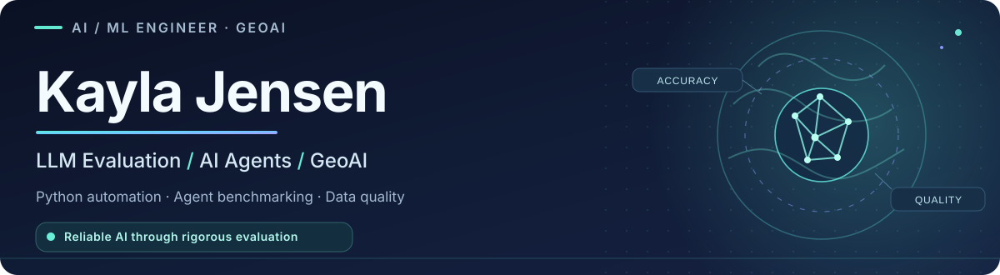
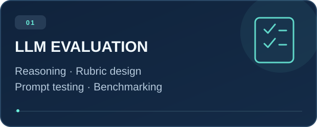
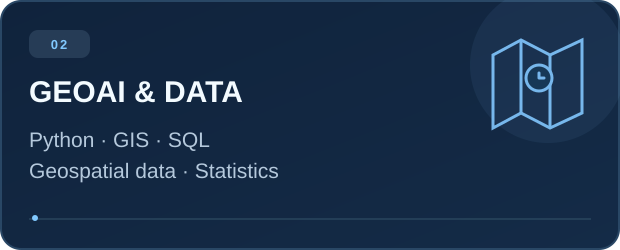
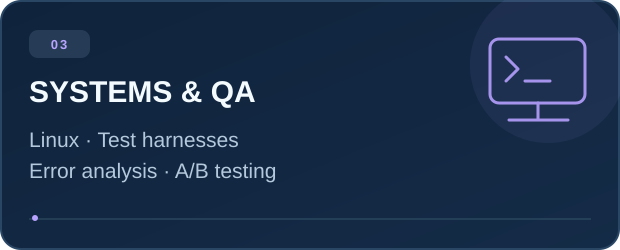

<div align="center">



### Building reliable AI systems through rigorous evaluation and real-world engineering.

<a href="https://www.linkedin.com/in/kayla-jensen-b060a3393/"></a>
<a href="mailto:kaylarjensen21@gmail.com"></a>


</div>

---

## 👋 About me

I'm **Kayla Jensen**, an **AI/ML Evaluation Engineer** with a multidisciplinary background in **geospatial analytics, software automation, and systems engineering**. I work at the intersection of **model quality**, **structured technical data**, and **practical engineering**.

My experience includes evaluating LLM outputs for **accuracy, reasoning, and instruction adherence**; developing evaluation rubrics and test scenarios; analyzing failure modes; and applying **Python, GIS, and data-quality workflows** to complex technical problems.

I believe useful AI needs to be more than impressive in a demo — it must be **reliable, measurable, and dependable in real-world conditions**.

## ✦ Focus areas

<div align="center">
<table>
<tr>
<td width="50%"></td>
<td width="50%"></td>
</tr>
<tr>
<td colspan="2" align="center"></td>
</tr>
</table>
</div>

## 🛠️ Technical toolkit

| Domain | Tools, methods & specialties |
| :-- | :-- |
| **Programming & data** | Python · SQL · Statistics · Data Management |
| **LLM & agent evaluation** | LLM output review · Rubric design · Prompt evaluation · SWE-bench-style and Terminal-Bench-style tasks |
| **Model quality** | Error analysis · A/B testing · Harness-based testing · Quality assurance |
| **Geospatial & engineering** | GIS · Geospatial datasets · CAD · Technical analysis |
| **Working environments** | Linux · Terminal workflows · Technical documentation |

## 🔍 My approach to AI quality

```text
Define success criteria
        ↓
Build realistic evaluation cases
        ↓
Test outputs and agent behavior
        ↓
Analyze errors and edge cases
        ↓
Document insights and improve reliability
```

I focus on **repeatable evaluations**, **clear evidence**, and **actionable feedback** — so teams can identify what their models do well, where they fail, and how to improve them.

## 💼 Experience

| Period | Role | Organization |
| :-- | :-- | :-- |
| **2024 – Present** | AI/ML Engineer · GIS & Geospatial Data Analytics | **EBH Engineering** |
| **2023 – 2024** | Electro Mechanical Engineer | **B&C Specialty Products, Inc.** |
| **2021 – 2022** | System Engineer | **Full Vision, Inc.** |

- **EBH Engineering:** LLM-output assessment, Python and geospatial data workflows, prompt testing, A/B testing, evaluation criteria, and performance documentation.
- **B&C Specialty Products:** Troubleshooting, technical testing, reliability and quality improvements for electromechanical systems.
- **Full Vision:** Prototype testing, performance analysis, quality checks, and engineering documentation.

## 🎓 Education

**Bachelor of Science in Computer Science**  
Wichita State University · 2019–2023

## 🤝 Let's connect

Interested in **LLM evaluation**, **AI agent benchmarking**, **GeoAI**, or **technical data quality**? I'm always happy to connect with people solving difficult engineering and AI-reliability problems.

<div align="center">

**[LinkedIn](https://www.linkedin.com/in/kayla-jensen-b060a3393/) · [Email](mailto:kaylarjensen21@gmail.com)**

<sub>Quality-first AI • Geospatial thinking • Engineering discipline</sub>

</div>
